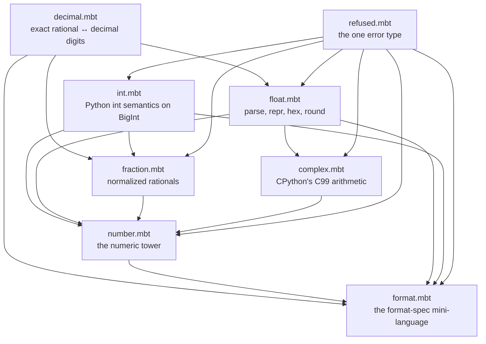
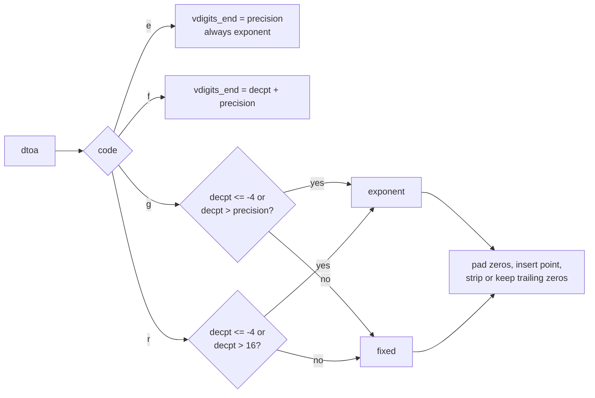
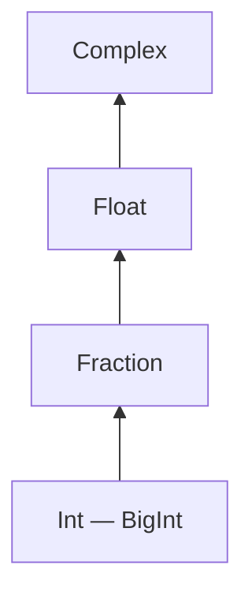

# moonnum — design

`moonnum` gives MoonBit Python's numbers: arbitrary-precision integers, floats,
complex numbers and exact fractions, read and written the way Python reads and
writes them, formatted with Python's format-specification mini-language.

The reference is CPython 3.15. Every place this document says "as Python does",
the authority is the CPython source (`Objects/floatobject.c`,
`Objects/complexobject.c`, `Objects/unicode_formatter.c`, `Python/pystrtod.c`,
`Lib/fractions.py`), not memory of it.

## What this is not

* Not a decimal type. `decimal.Decimal` has a context, signals and rounding
  modes; that is a separate problem with a separate audience.
* Not a bignum encoding. `moonvar` owns variable-length integer encodings.
* Not a complex-math library. `cmath` functions are out until something needs
  them.

## The shape of the library

One package, `moonbitstack/moonnum`, in `src/`. Files are split by subject, not
by layer, so a reader looking for "how floats print" opens `float.mbt` and finds
both the entry point and the call into the kernel.



`decimal.mbt` is the kernel and is private. It is the only file that knows how
to turn an IEEE-754 value into decimal digits, and everything that has to agree
with Python's text output goes through it: `repr_float`, `float_hex`'s
neighbourhood, `format`'s `e`, `f`, `g` and `%` types, and the float branch of
`Fraction`.

## The kernel: exact, not approximate

Python's float formatting is *correctly rounded*: the digits it prints are the
decimal expansion of the exact binary value, rounded once, half to even. Doing
that with `Double` arithmetic is impossible past 17 digits, so the kernel
carries a rational as a pair of `BigInt`:

```
value = num / den          (den > 0, sign lives in num)
```

Three primitives sit on top of that pair.

**`floor_log10(num, den) -> Int`.** The unique `e` with `10^e <= num/den <
10^(e+1)`. Estimated from the decimal lengths of `num` and `den`, then corrected
by one comparison against `10^e`, so it is exact and never loops.

**`round_to_digits(num, den, digits) -> (String, Int)`.** Round to `digits`
significant decimal digits, half to even. Uses `floor_log10` to find the decimal
exponent `e`, then computes

```
q, r = divmod(num * 10^(digits - 1 - e), den)
```

and rounds `q` up when `2r > den`, or when `2r == den` and `q` is odd. Returns
the digits and the exponent, and normalizes `999…9 → 1000…0` by shifting the
exponent.

**`round_to_place(num, den, place) -> (String, Int)`.** The same, but to a fixed
power of ten rather than a fixed count of digits: `q = round(num / (den *
10^-place))`. This is what `round(x, n)`, `Fraction` formatting and `%` need.

A `Double` becomes a rational exactly, from its bits:

```
normal:    m = 2^52 + frac,  e = exp - 1075   →  m * 2^e
subnormal: m = frac,          e = -1074
```

so `0.1` is `3602879701896397 / 2^55`, and `repr` of it can be `0.1` because the
shortest string that rounds back is found by *checking*, not by printing.

### `dtoa`

`dtoa(d, mode, precision) -> Dec` mirrors Gay's `dtoa` as CPython uses it:

| mode | meaning | who needs it |
|:--|:--|:--|
| 0 | shortest string that round-trips; `precision` ignored | `repr`, `format` with no type and no precision |
| 2 | exactly `precision` significant digits, half to even | `e`, `g`, `n` |
| 3 | exactly `precision` digits after the point | `f`, `%` |

Mode 2 and 3 are computed by the kernel. Mode 0 takes the shortest digit string
the platform already produces (`Double::to_string`, which is Ryū) and re-derives
`(digits, decpt)` from it, stripping the trailing zeros and normalizing the
point. Ryū and CPython's `dtoa` both produce the shortest round-tripping digits;
they differ only in how they spell them, which is exactly the part discarded
here. The generated vectors include a large random sweep so that a divergence,
if one ever appears, fails the build instead of the reader.

`Dec` is `{ neg : Bool, digits : String, decpt : Int }`: `digits` has no point
and no sign, and the value is `0.digits × 10^decpt`. Everything downstream —
scientific versus fixed, padding, grouping — is a decision made on `decpt`,
which is why one string builder serves `repr`, `format` and `show` alike.

### Building the text

`render_float(d, code, precision, flags) -> String` is a transcription of
CPython's `format_float_short`, keeping its variable names where they still make
sense (`decpt`, `vdigits_start`, `vdigits_end`) because the case analysis is the
algorithm:



The `r` thresholds (`decpt <= -4` or `decpt > 16`) are Python's, and they are
why `repr(1e16) == '1e+16'` while `repr(1e15) == '1000000000000000.0'`. The
comment in `pystrtod.c` about `2e16+8` explains why the cut is at 16 and not 17:
a 16-digit shortest repr padded with zeros would print a number that is not the
one stored.

## The numeric tower



Comparison and arithmetic promote along the arrows, exactly as Python's
`numbers` tower does, but *comparison is exact*: an `Int` and a `Float` are
compared by giving the float its exact rational value, never by rounding the
integer to a double. `2^53 + 1` therefore compares greater than `2^53`, which a
`Double`-only implementation gets wrong.

`1 == 1.0 == Fraction(1) == 1+0j` holds. `nan != nan` holds at every level;
ordering with a `nan` raises, and so does ordering a `Complex` by magnitude-
less comparison — Python's answer is `TypeError`, ours is `Refused::Domain`
with a reason string.

Promotion of results:

```
Int   ⊕ Int    → Int        (except / , which is Float)
Int   ⊕ Frac   → Frac
*     ⊕ Float  → Float
*     ⊕ Complex→ Complex
```

`Fraction` keeps one invariant, and every constructor enforces it: `den > 0` and
`gcd(num, den) == 1`. Because the fields are public (`pub(all)`) a caller can
break it; the methods cannot. That trade is deliberate — the same trade Python
makes with `_numerator` — and it is why `Fraction::new` is the documented way in.

## Errors

```moonbit
pub(all) suberror Refused {
  Malformed(at~ : Int, reason~ : String)   // a parse failure, with where
  ZeroDivision                             // 1/0, 1%0, Fraction(1, 0)
  Overflow(reason~ : String)               // out of range for the target type
  Domain(reason~ : String)                 // defined input, undefined answer: isqrt(-1)
}
```

`at` is an offset in UTF-16 code units, the unit `StringView` and JavaScript both
count in, so a caller can slice the offending text without translating. It
points at the first character that made the input unacceptable, not at the end of
what was scanned.

Every function that can fail says `raise Refused` and nothing else. A library
that raises two unrelated error types forces every caller to write two handlers;
Python gets away with `ValueError`/`OverflowError` because it has exceptions
everywhere. One type with four cases is the smallest thing that still names the
four different situations.

## Parsing

| input | function | grammar |
|:--|:--|:--|
| integer | `parse_int(text, base~ = 10)` | optional sign, optional base prefix when `base` is 0, digits with single underscores between them, surrounding whitespace |
| float | `parse_float(text)` | `float(s)`: `inf`/`infinity`/`nan` in any case with optional sign, decimal and exponent forms, underscores between digits |
| complex | `parse_complex(text)` | `complex(s)`, plus `i` as an accepted imaginary suffix and `(…)` around the whole |
| fraction | `parse_fraction(text)` | `Fraction(str)`: `3/4`, `1.25`, `1e-3`, `7`, whitespace anywhere, underscores between digits |
| any | `parse(text)` | the four above, dispatched on shape: `/` → fraction, `j`/`i` suffix → complex, `.`/`e`/`inf`/`nan` → float, else integer |

Underscore placement is checked during the scan rather than by a regex: an
underscore is legal only when the previous and next characters are digits of the
current base. That is stricter than "contains an underscore" and is what makes
`1__0`, `_1` and `1_` fail with the offset of the second offending character.

The fractional forms are read into `num/den` directly, not via `parse_float`, so
`parse_fraction("0.1")` is `1/10` and not the binary approximation of `0.1`.
This is the one place where "looks like Python" and "is Python" could diverge
without anyone noticing, so it is tested by construction from strings whose
denominators are powers of ten.

## Formatting

The mini-language, in the order the spec is parsed (CPython's
`parse_internal_render_format_spec`, same order, same errors):

```
[[fill]align][sign][z][#][0][width][grouping][.precision][type]
```

with `align ∈ < > ^ =`, `sign ∈ + - space`, `grouping ∈ , _`, and
`type ∈ b c d e E f F g G n o x X %` or absent.

Rendering is the same six-part layout CPython uses:

```
<left pad><sign><prefix><zero pad><grouped digits><point+frac><exponent><right pad>
```

Grouping is a function of the type, not of the grouping character alone:

| type | `,` | `_` |
|:--|:--|:--|
| `d`, `n`, and float types | every 3 digits | every 3 digits |
| `b`, `o`, `x`, `X` | rejected | every 4 digits |

Zero padding participates in grouping: `format(1234567, '012,d')` is
`0,001,234,567` and not `0001234,567`. Getting this right means computing the
zero run *with* the separators in place, so the code pads, groups, counts, and
pads again until the width is met — at most two iterations.

Per-type notes that are easy to get wrong, all taken from the sources above:

* `z` coerces a negative zero to a positive zero *before* the sign is chosen, so
  `format(-0.0, 'z') == '0.0'` and `format(-0.0001, '.2z') == '0.00'`.
* `#` keeps the trailing zeros for `g`/`G` and forces the point; for integers it
  adds `0b`/`0o`/`0x`.
* `%` multiplies by 100, then formats as `f`, then appends `%`.
* `n` is `d`/`g` with the C locale's separators, which are none — documented,
  because a MoonBit program has no locale to consult.
* `c` takes no sign, no `#`, no grouping and no precision.
* Precision on an integer type is an error; `z` on an integer type is an error.
* `Complex` refuses `0` fill and `=` alignment, and drops the parentheses and the
  real part when the real part is positive zero: `format(2j, '') == '2j'`.
* `Fraction` with no type prints `num/den` (and `num` when the denominator is 1);
  with a float type it formats the exact rational, which is why
  `format(Fraction(1, 3), '.10f')` is `0.3333333333` and not the float's
  `0.3333333333`.
* `Decimal` types are not accepted; a `Fraction` with `d` is an error, as in
  Python 3.15.

## Public interface

Signatures, in the form the library ships them. `BigInt` is core's; this library
adds functions and does **not** wrap it in a new type.

```moonbit
// refused.mbt
pub(all) suberror Refused { Malformed(at~ : Int, reason~ : String); ZeroDivision
                            Overflow(reason~ : String); Domain(reason~ : String) }

// int.mbt
pub fn parse_int(text : StringView, base~ : Int = 10) -> BigInt raise Refused
pub fn floordiv(a : BigInt, b : BigInt) -> BigInt raise Refused
pub fn floor_mod(a : BigInt, b : BigInt) -> BigInt raise Refused
pub fn divmod(a : BigInt, b : BigInt) -> (BigInt, BigInt) raise Refused
pub fn power(base : BigInt, exp : BigInt, modulus? : BigInt) -> BigInt raise Refused
pub fn gcd(a : BigInt, b : BigInt) -> BigInt
pub fn lcm(a : BigInt, b : BigInt) -> BigInt
pub fn isqrt(n : BigInt) -> BigInt raise Refused
pub fn factorial(n : BigInt) -> BigInt raise Refused
pub fn comb(n : BigInt, k : BigInt) -> BigInt raise Refused
pub fn perm(n : BigInt, k : BigInt) -> BigInt raise Refused
pub fn to_bytes(n : BigInt, length~ : Int, big~ : Bool = true, signed~ : Bool = false) -> Bytes raise Refused
pub fn of_bytes(bytes : BytesView, big~ : Bool = true, signed~ : Bool = false) -> BigInt

// float.mbt
pub fn parse_float(text : StringView) -> Double raise Refused
pub fn repr_float(d : Double) -> String
pub fn float_hex(d : Double) -> String
pub fn float_of_hex(text : StringView) -> Double raise Refused
pub fn round_float(d : Double, ndigits~ : Int) -> Double raise Refused
pub fn round_big(d : Double) -> BigInt raise Refused
pub fn floor_big(d : Double) -> BigInt raise Refused
pub fn ceil_big(d : Double) -> BigInt raise Refused
pub fn trunc_big(d : Double) -> BigInt raise Refused
pub fn as_ratio(d : Double) -> Fraction raise Refused
pub fn as_integer_ratio(d : Double) -> (BigInt, BigInt) raise Refused

// complex.mbt
pub(all) struct Complex { re : Double, im : Double }
pub fn Complex::new(re : Double, im : Double) -> Complex
pub fn parse_complex(text : StringView) -> Complex raise Refused
pub fn Complex::abs(self) -> Double
pub fn Complex::conjugate(self) -> Complex
pub fn Complex::pow(self, w : Complex) -> Complex
pub fn repr_complex(z : Complex) -> String
// impl Add, Sub, Mul, Div, Neg, Eq, Show, Default

// fraction.mbt
pub(all) struct Fraction { num : BigInt, den : BigInt }
pub fn Fraction::new(num : BigInt, den : BigInt) -> Fraction raise Refused
pub fn Fraction::of_int(n : BigInt) -> Fraction
pub fn Fraction::of_float(d : Double) -> Fraction raise Refused
pub fn parse_fraction(text : StringView) -> Fraction raise Refused
pub fn Fraction::numerator(self) -> BigInt
pub fn Fraction::denominator(self) -> BigInt
pub fn Fraction::abs(self) -> Fraction
pub fn Fraction::reciprocal(self) -> Fraction raise Refused
pub fn Fraction::is_integer(self) -> Bool
pub fn Fraction::to_double(self) -> Double
pub fn Fraction::floor_big(self) -> BigInt
pub fn Fraction::ceil_big(self) -> BigInt
pub fn Fraction::round_big(self) -> BigInt
pub fn Fraction::round(self, ndigits~ : Int) -> Fraction
pub fn Fraction::limit_denominator(self, max~ : BigInt) -> Fraction raise Refused
pub fn repr_fraction(f : Fraction) -> String
// impl Add, Sub, Mul, Div, Neg, Eq, Compare, Show, Default

// number.mbt
pub(all) enum Number { Int(BigInt); Float(Double); Complex(Complex); Fraction(Fraction) }
pub fn parse(text : StringView) -> Number raise Refused
pub fn Number::compare_numeric(self, other : Number) -> Int raise Refused
pub fn Number::equal_numeric(self, other : Number) -> Bool
pub fn Number::floordiv(self, other : Number) -> Number raise Refused
pub fn Number::floor_mod(self, other : Number) -> Number raise Refused
pub fn Number::pow(self, exp : Number) -> Number raise Refused
pub fn Number::to_double(self) -> Double raise Refused
// impl Add, Sub, Mul, Div, Neg, Eq, Show

// format.mbt
pub fn format(value : Number, spec : StringView) -> String raise Refused
pub fn format_int(n : BigInt, spec : StringView) -> String raise Refused
pub fn format_float(d : Double, spec : StringView) -> String raise Refused
pub fn Fraction::format(self, spec : StringView) -> String raise Refused
pub fn Complex::format(self, spec : StringView) -> String raise Refused
```

Three naming decisions worth stating once:

**No methods on foreign types.** MoonBit rejects `fn Double::f` for a type it
does not own, so everything that operates on `Double` or `BigInt` is a free
function. Methods are used where the receiver is ours (`Complex`, `Fraction`,
`Number`), which is also where chaining reads better.

**`power`, not `pow`.** Core's `BigInt::pow` exists with a different contract;
two `pow`s in one scope would make every call site ask which one it got.
`Complex::pow` is ours, so it keeps Python's name.

**`round_float` and `round_big`.** Python's `round(x)` returns `int` and
`round(x, n)` returns `float`; a MoonBit function has one return type. The split
is explicit in the name, and both are tested against the same half-to-even rule.

## Files

| file | contains | public? |
|:--|:--|:--|
| `src/refused.mbt` | `Refused` and the internal `raise` helpers | type only |
| `src/decimal.mbt` | `Dec`, `dtoa`, `floor_log10`, rounding, `pow10`, digit grouping | no |
| `src/spec.mbt` | `Spec` parsing and the six-part layout | no |
| `src/int.mbt` | integer functions over `BigInt` | yes |
| `src/float.mbt` | float parse/print/hex/round | yes |
| `src/complex.mbt` | `Complex` and CPython's arithmetic | yes |
| `src/fraction.mbt` | `Fraction` | yes |
| `src/number.mbt` | `Number`, `parse`, the tower | yes |
| `src/format.mbt` | the mini-language | yes |

## Testing

`scripts/gen_vectors.py` runs CPython and writes `src/vectors.mbt`: literal
arrays of input and expected output, one array per subject. Tests in
`src/*_test.mbt` iterate over those arrays and compare. No Python runs in CI, and
no test computes an expected value with the same code it is testing.

The vectors cover: each base's integers with prefixes and underscores and their
rejected forms; float specials and a random sweep of 2,000 bit patterns for
`repr` round-trip; every complex spelling Python accepts; fractions from strings
with power-of-ten denominators; `round` at every half-way case; `divmod` and
`pow` over all four sign combinations; and `format` for the cross product of
{type} × {sign} × {grouping} × {fill/align} × {width} × {precision}, sampled where
the cross product is too large to write out.

`moon check --target all --deny-warn`, `moon test --target all` on wasm,
wasm-gc, js and native.

## Documentation

Three layers, because they answer three different questions.

1. **Home** (`docs/index.html`) — what this is, why the numbers are exact, and a
   live example. It is a landing page, not a manual.
2. **Tutorial** (`docs/01-…` to `docs/05-…`) — a path through the four number
   kinds and the format language, each page runnable as written.
3. **API reference** (`docs/api.html`) — every public item, grouped by subject,
   generated from the module interface (`src/pkg.generated.mbti`) by
   `scripts/gen_api.py` so it cannot drift from the code.

Plus `docs/algorithms.html` for the parts that are easier to see than to read:
the tower, the `dtoa` modes, the six-part layout.
